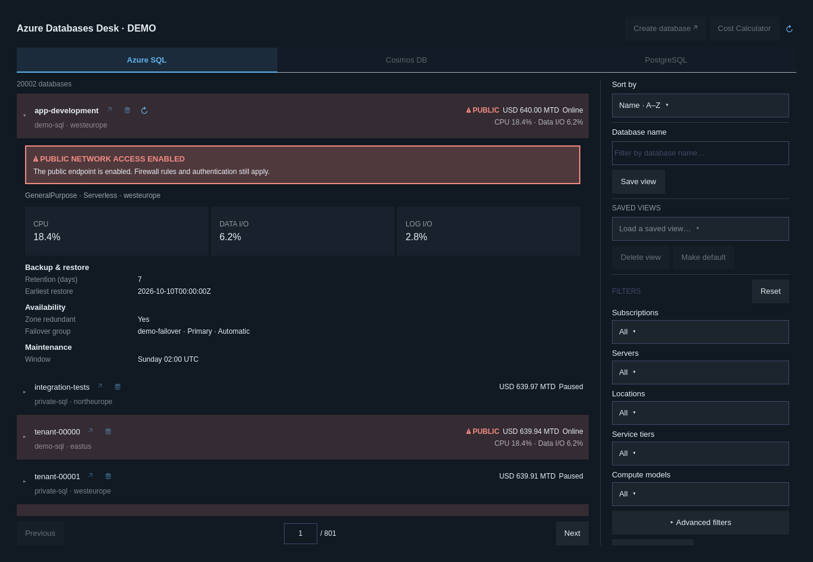

# Azure Databases Desk

An Omarchy bar plugin for browsing **Azure SQL** databases, checking live state and public access, and viewing posted month-to-date costs. Switch between remembered Azure accounts and Microsoft Entra directories without changing your terminal's account when using an added profile.



**Version:** 0.8.0 · **Plugin ID:** `azure-databases-desk` · **License:** [MIT](LICENSE)

## Features

- Fresh pages of **25 databases**, searchable filters and sorting by name, cost, location, tier or state.
- Current-page ARM state and metrics, refreshed on opening and every 10 minutes; configurable up to 60 minutes. Closing the panel cancels work.
- A prominent warning when the server's public-network setting is Enabled. Unknown settings remain unknown.
- Posted **month-to-date actual costs**, with currency checks and explicit handling of unavailable costs and shared pools.
- Backup/restore, failover-group, maintenance and availability details on expansion, plus an explicit row refresh.
- Searchable multiselect filters for subscription, server, region, service tier, compute, backup redundancy, restore history, maintenance, zone redundancy and read scale-out.
- Saved views and a default view; remembered accounts with a separate directory selector.
- Azure Portal shortcuts and an optional shortcut to an already-installed DB Studio workbench.

**Azure SQL is the enabled service.** Cosmos DB, PostgreSQL and Cost Calculator are disabled and marked Coming soon. No resource changes, restores, failovers or SQL queries are executed by this plugin.

## Requirements

| Dependency | Purpose |
| --- | --- |
| Omarchy Quattro with its bar-widget/plugin API | Host shell and plugin management |
| Quickshell, Qt Quick/Controls and Omarchy shell QML modules | Panel rendering; supplied by the desktop |
| Python 3.10+ | Standard-library helper, preferences and Azure CLI subprocesses; no pip packages |
| Azure CLI (`az`) | Azure sign-in and management API reads |
| Bash and normal Omarchy desktop tools | Explicit setup terminal, browser launch and plugin IPC |
| DB Studio and its own dependencies, optional | Separate SQL workbench; installed and configured independently |
| `notify-send`, optional | Notification when the optional workbench is unavailable |

The Azure identity needs read access to Resource Graph and SQL resources, Monitor metrics access for charts, and Cost Management access for billing. Missing optional permissions are reported; the panel does not invent healthy states or available costs. Reading backup/failover settings can require additional ARM read permissions. Accounts with no accessible subscriptions have an empty resource view.

## Install

Review the source and [security policy](SECURITY.md), then install the repository:

```bash
omarchy plugin add https://github.com/dimitrijemaric/omarchy-azure-databases-desk.git --enable
```

The repository contains one self-contained plugin with a root `manifest.json`. Installation has no setup hooks and does not install packages or change Azure resources. Enabling adds the widget to the right side of the bar.

Open the database icon in the bar. If Azure CLI is missing, choose **Install Azure CLI**; this opens a terminal and explicitly invokes `omarchy pkg add azure-cli`. Omarchy's package manager may request your password. Choose **Sign in to Azure** and complete Microsoft's browser/MFA flow. These terminal commands provide the same setup:

```bash
bash scripts/setup.sh install
bash scripts/setup.sh login
```

Azure CLI owns sign-in credentials and token refresh. The plugin never asks for an Azure password.

## Use

- Open **Accounts ▾** in the header to reveal Account and Directory. The **+** beside Account adds a separate sign-in; **+** beside Directory signs the selected account into another tenant. Both selectors are searchable. They collapse when the panel closes.
- Choose filters on the right; **All** clears a filter category. Advanced filters contain backup, maintenance and availability options. Database-name search and **Save view** sit below Sort by.
- Name a new view and optionally make it default. Loaded views offer explicit Update or Save as new. The default loads on page one whenever the panel opens.
- Expand a database to refresh its state and network setting, then read operational details. Use its small refresh icon for another read. **Ctrl R** refreshes the page and filter options.
- Use Previous/Next or the page-number field. Normal browsing fetches only that page's costs. Global cost sorting builds a bounded ranking in panel memory; page navigation reuses it. Reopen, filter changes, month changes and explicit refresh discard the ranking.

Azure services have independent cooldowns after rate limits; a billing or metrics cooldown does not suppress ARM public-access checks. The minimum automatic refresh interval is ten minutes:

```bash
omarchy bar set azure-databases-desk liveRefreshIntervalSec 600 --json
```

See [the detailed usage guide](docs/USAGE.md) for filtering semantics, account isolation, costs and live monitoring, and [resource data](docs/RESOURCE_DATA.md) for API coverage.

## Security and local data

The plugin runs **unsandboxed** in `omarchy-shell`, starts Python/Azure CLI helpers and contacts Azure management, identity, monitoring and billing services. Portal actions open Microsoft Azure Portal. It has no independent analytics endpoint. No sudoers rule, background service or scheduler is installed. See [SECURITY.md](SECURITY.md) for command, network and credential boundaries.

Resource and billing data are not persisted. Saved views, account metadata and added Azure CLI profiles live under `${XDG_STATE_HOME:-~/.local/state}/azure-sql-desk/`. Preferences use SQLite files with mode 0600. Added credential-profile directories use mode 0700; Azure CLI manages their contents. The shared CLI account uses `AZURE_CONFIG_DIR` or `~/.azure`. Treat credential profiles as sensitive local data.

The preview contains fictional resources, not a real Azure account. The optional workbench shortcut passes no credentials and runs no query; DB Studio is independent software.

## Update and remove

Review upstream changes before updating:

```bash
omarchy plugin update azure-databases-desk
```

Disable temporarily or remove the plugin:

```bash
omarchy plugin disable azure-databases-desk
omarchy plugin remove azure-databases-desk
```

Removal stops the plugin and removes its checkout/bar registration. It preserves saved views, remembered accounts, added CLI credential profiles and the shared CLI login. To remove local plugin data as well, close the panel and deliberately delete the `azure-sql-desk` state directory after checking its contents; that also deletes saved views and added credential profiles. Do not delete `~/.azure` to remove this plugin. Azure CLI, DB Studio and their packages are independently managed and remain installed.

## Limitations

- Metrics batching currently targets Azure public cloud. Government/China portal and sign-in choices exist, but their regional metrics endpoints are not yet implemented.
- Resource Graph and posted Azure costs can lag current resource state. Shared elastic-pool compute is not allocated across databases. Unknown costs sort last; mixed billing currencies cannot be globally sorted.
- Broad cost sorting requires discovery of matching IDs and billing aggregates and supports up to 100,000 matches. It can be slower than normal page browsing.
- A public-access warning describes Azure's endpoint setting; firewall rules and authentication still apply. Absence of a warning is not a network-security audit.
- Automated checks use fixtures. Live large-tenant latency, tenant quotas and every permission combination have not been validated.

## Development and release

```bash
python3 -B scripts/check_release.py
python3 -B -m unittest discover -s tests
omarchy plugin validate .
python3 -B scripts/qml_check.py
```

The native QML checks require an Omarchy desktop with QtTest. GitHub CI runs portable preflight, shell syntax and offline Python checks. To open a fictional demo that uses temporary preferences and makes no Azure calls:

```bash
python3 -B scripts/simulate.py
```

See [CONTRIBUTING.md](CONTRIBUTING.md), [release checks](docs/RELEASE.md), and [CHANGELOG.md](CHANGELOG.md). Report ordinary bugs through [GitHub Issues](https://github.com/dimitrijemaric/omarchy-azure-databases-desk/issues); use private reporting for vulnerabilities.

Copyright © 2026 Dimitrije Maric. Released under the [MIT license](LICENSE). Omarchy, Azure CLI, Qt/Quickshell and DB Studio retain their own licenses and trademarks. This project is not affiliated with Microsoft or Omarchy.
